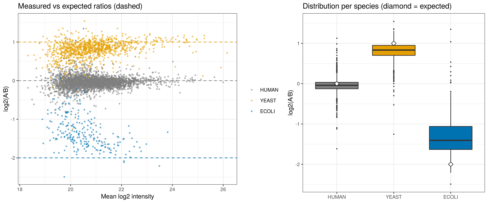

# Benchmark results

Generated 2026-10-23 with sparcproteomics 0.1.0. Rerun with `Rscript benchmark/run_benchmark.R`.

**Dataset:** PXD028735 (Van Puyvelde et al. 2022), Q Exactive HF-X DDA, condition A vs B,
3 replicates each; precursor-level quantification from ProteoBench (WOMBAT-P).
1076 yeast, 245 *E. coli* and 3023 human proteins tested with default settings.
Expected log2(A/B): human 0, yeast +1, *E. coli* -2.

**Scoring:** significant = BH-adjusted p < 0.05 and |log2FC| >= 0.585. A true positive is a
yeast or *E. coli* protein called significant in the expected direction; any other significant
call is false. Sensitivity = true positives / yeast + *E. coli* proteins tested. FDP = false /
all significant calls. "FDP, adj. p only" drops the fold-change cutoff. Bias = median log2FC
minus the expected value. No imputation is used for testing.

## Effect of the statistical test (median-polish summarization)

| Normalization | Test | Significant | Sensitivity | FDP | FDP, adj. p only |
|---|---|---|---|---|---|
| median (all proteins) | limma | 1037 | 78.0% | 0.7% | 17.7% |
| median (all proteins) | welch | 618 | 46.8% | 0.0% | 12.4% |
| median (all proteins) | student | 913 | 69.1% | 0.0% | 17.2% |
| median (human reference) | limma | 1142 | 86.1% | 0.4% | 2.6% |
| median (human reference) | welch | 761 | 57.5% | 0.1% | 1.0% |
| median (human reference) | student | 1016 | 76.8% | 0.1% | 3.2% |
| none | limma | 1184 | 88.4% | 1.4% | 1.3% |
| none | welch | 0 | 0.0% | 0.0% | 0.0% |
| none | student | 0 | 0.0% | 0.0% | 0.0% |

## Effect of summarization and normalization (limma)

| Summarization | Normalization | Sensitivity | FDP | Bias human | Bias yeast | Bias E. coli |
|---|---|---|---|---|---|---|
| median_polish | median (all proteins) | 78.0% | 0.7% | -0.15 | -0.27 | 0.49 |
| median_polish | median (human reference) | 86.1% | 0.4% | 0.00 | -0.13 | 0.64 |
| median_polish | none | 88.4% | 1.4% | 0.06 | -0.07 | 0.69 |
| top3 | median (all proteins) | 52.5% | 9.5% | -0.13 | -0.28 | 0.65 |
| top3 | median (human reference) | 56.5% | 10.4% | -0.04 | -0.19 | 0.75 |
| top3 | none | 54.3% | 9.6% | 0.09 | -0.06 | 0.87 |
| sum | median (all proteins) | 63.7% | 5.5% | -0.13 | -0.22 | 0.45 |
| sum | median (human reference) | 69.6% | 5.4% | -0.02 | -0.12 | 0.56 |
| sum | none | 71.5% | 5.3% | 0.07 | -0.02 | 0.66 |

All 27 combinations, with precision (MAD) per species, are in `results/metrics.csv`.

